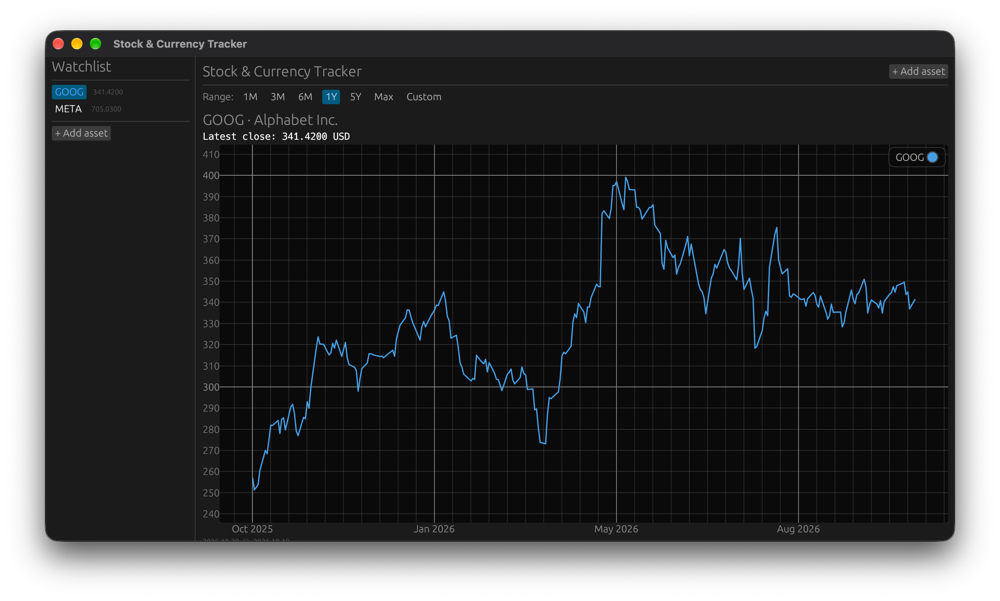

# Stock & Currency Tracker

A cross-platform **desktop application for tracking stocks and currencies**,
built in [Rust](https://www.rust-lang.org) with
[eframe / egui](https://eframe.rs). Search for assets, store them as
favorites, view interactive historical charts, build and save custom
multi-asset comparisons (e.g. *GOOGL vs META* or *CAD vs MXN*), and run
**historical currency conversions** ("What was 2,000,000 MXN worth in CAD on
2019-03-14?"). All market data is cached locally in SQLite, so the app keeps
working offline after the first download.




> **Status:** the data layer (network sources, SQLite persistence, shared
> models) is complete and compiles cleanly with `cargo check`. The
> interactive UI, charts and converter are still being wired up. This document
> is the build / run / release guide for the project as a whole.

---

## Features

- 🔎 **Search** stocks, funds and currencies via Yahoo Finance (no API key).
- ⭐ **Favorites** — add assets, filter them, refresh their historical data.
- 📈 **Interactive charts** — zoom, pan, hover tooltips, boxed zoom, a
  toggleable legend, and a time-range selector (1M … Max / Custom).
- 🧪 **Custom charts** — save and reopen multi-asset comparisons, each with its
  own settings (normalize, base currency, interval, date range).
- 💱 **Historical currency converter** — frankfurter.dev rates, with the
  nearest available date used for weekends / holidays.
- 💾 **Offline-first** — a bundled [SQLite](https://www.sqlite.org) database
  (compiled from source via the `rusqlite` *bundled* feature), no system DB.
- 🖥️ **Native & lightweight** — a single binary, dark theme by default.

## Tech stack

| Concern          | Choice                                     |
|------------------|--------------------------------------------|
| GUI              | `eframe` + `egui` + `egui_plot` (v0.29)    |
| Charts           | `egui_plot` (zoom / pan / hover / boxed)   |
| HTTP             | `reqwest` (blocking, JSON)                 |
| Database         | `rusqlite` (bundled SQLite)                |
| Serialization    | `serde` + `serde_json`                     |
| Dates            | `chrono`                                   |
| Errors / logging | `anyhow`, `thiserror`, `env_logger`        |

## Data sources (no API keys)

- **Stocks / crypto** — Yahoo Finance public endpoints:
  - search: `v1/finance/search`
  - history: `v8/finance/chart` (adjusted close, dividends & splits)
- **Currencies** — [frankfurter.dev](https://frankfurter.dev)
  - list: `v1/currencies`
  - rates: `v1/{base}/{target}?from=…&to=…`

These endpoints are free and key-less but **rate-limited**; every response is
treated as a retryable, cacheable condition.

## Project structure

```
.
├── Cargo.toml              # manifest + [package.metadata.bundle]
├── src/
│   ├── main.rs            # eframe entry point
│   ├── app.rs             # main App struct (impl eframe::App)
│   ├── models.rs          # Asset, PricePoint, CustomChart, TimeRange, …
│   ├── db.rs              # SQLite schema + data-access layer
│   └── data/
│       ├── mod.rs         # shared blocking HTTP client
│       ├── yahoo.rs       # stock / crypto search + history
│       └── frankfurter.rs # currency list + conversion
├── scripts/               # cross-platform release helpers
└── specs.md               # original technical specification
```

## Requirements

**Toolchain**

- Rust stable (tested with the 1.9x series) + Cargo —
  <https://www.rust-lang.org/tools/install>
- The MSVC or GNU target depending on platform (see *Releasing*)
- A C compiler is only needed to build the bundled SQLite sources.

**Per-OS system dependencies.** The GUI backend needs X11/Wayland/OpenGL
development libraries on Linux; macOS and Windows need nothing beyond the
toolchain.

*macOS*
```sh
xcode-select --install            # Xcode Command Line Tools
```

*Linux (Debian/Ubuntu)*
```sh
sudo apt-get install -y build-essential \
  libx11-dev libxrandr-dev libxkbcommon-dev \
  libwayland-dev libgl1-mesa-dev libasound2-dev
# optional, for .deb / AppImage packaging:
sudo apt-get install -y dpkg-deb linuxdeploy
```
> Some distros pull a few extra `-dev` packages; if the build complains, install
> the named library and retry.

*Windows*
- Install **Visual Studio 2022** with the *Desktop development with C++*
  workload (provides the MSVC toolchain + Windows SDK), then:
  ```sh
  rustup target add x86_64-pc-windows-msvc
  ```

## Build & run

```sh
# from the repository root
cargo build --release
./target/release/stock_currency_tracker        # macOS / Linux
.\target\release\stock_currency_tracker.exe     # Windows

# or, for development, run straight in debug
cargo run
```

### Where data is stored

The app keeps a single SQLite database. By default it lives next to the
executable (a `data/` folder) so it stays portable; the schema is created and
migrated automatically on first launch. The database is plain,
human-readable SQLite — open it with any SQLite tool to inspect or back up.

## Configuration

Nothing to configure — every data source is a key-less public endpoint. Enable
logging with `RUST_LOG` (`env_logger`):

```sh
RUST_LOG=debug ./target/release/stock_currency_tracker
```

---

## Releasing

Three kinds of artifacts are produced:

| Platform | Formats |
|----------|---------|
| **macOS**   | `.app` zip + `.dmg` |
| **Linux**   | portable `.zip` (+ optional `.AppImage`, `.deb`) |
| **Windows** | `.zip` (+ optional `.msi`) |

There are two ways to build them.

### 1. Native scripts (recommended)

Cross-compiling a GUI desktop binary to another OS is rarely practical, so each
platform is built **natively** on that platform. The orchestrator
[`scripts/release.sh`](scripts/release.sh) picks the right per-platform script
for the host OS and writes artifacts into `./dist`:

```sh
# make the scripts executable (one time)
chmod +x scripts/*.sh

# build a release for THIS platform
./scripts/release.sh
```

Per-platform entry points:

```sh
./scripts/release-macos.sh                          # .app + .dmg   (optional: sign / notarize)
./scripts/release-linux.sh                          # portable zip (+ AppImage if linuxdeploy present)
powershell -File scripts/release-windows.ps1        # .zip (+ MSI if cargo-bundle present)
# or, from Git Bash / MSYS2 on Windows:
./scripts/release-windows.sh
```

The scripts auto-install
[cargo-bundle](https://github.com/rust-analogy/cargo-bundle) when it is
missing. It reads the `[package.metadata.bundle]` block in `Cargo.toml` for the
product name, identifier, category and description. To embed application icons,
create `icons/icon.png` (1024×1024) and `icons/icon.ico`, then uncomment the
`icon = [...]` line in that block.

**Code signing & notarization (macOS, optional).** Pass a Developer ID and your
Apple credentials to sign and notarize the build:

```sh
SIGN_IDENTITY="Developer ID Application: Your Name (TEAMID)" \
NOTARIZE=1 \
APPLE_ID=you@example.com \
APPLE_PASSWORD=your-app-specific-password \
APPLE_TEAM_ID=TEAMID \
./scripts/release-macos.sh
```

> Unsigned builds run on Apple Silicon after right-click → *Open*. On Intel
> Macs users may need `xattr -d com.apple.quarantine`. Distribution via the Mac
> App Store or Gatekeeper-clean use requires signing + notarization.

### 2. Cross-platform via GitHub Actions

The workflow at
[`.github/workflows/release.yml`](.github/workflows/release.yml) builds
**all three** platforms on native runners, uploads the artifacts, and — when a
tag matching `v*` is pushed — creates a GitHub Release with the artifacts
attached. It also runs on manual *workflow_dispatch*.

```sh
# build & publish a release on GitHub
git tag v1.0.0
git push origin v1.0.0
```

| Platform | System requirements |
|----------|---------------------|
| macOS   | Xcode Command Line Tools. Signing / notarization optional. |
| Linux   | The dev libraries from *Requirements* + `linuxdeploy` for AppImage. The portable zip is always produced. |
| Windows | Visual Studio 2022 C++ workload + the MSVC target. |

---

## Development

```sh
cargo fmt --all
cargo clippy --all-targets -- -D warnings
cargo test            # runs once tests are added
cargo check           # fast compile-only check
```

## Roadmap / future work

- Technical indicators (SMA, RSI, …)
- Portfolio holdings & performance tracking
- Export charts as PNG
- Price-threshold alerts
- Multiple base currencies for FX charts

See [`specs.md`](specs.md) for the full original specification.

## License

[MIT](LICENSE) © 2026 Arnaud Selvais

## Disclaimer

This is a personal, hobby tool. Market data comes from third-party public
endpoints that may change or rate-limit at any time. Nothing here is financial
advice.